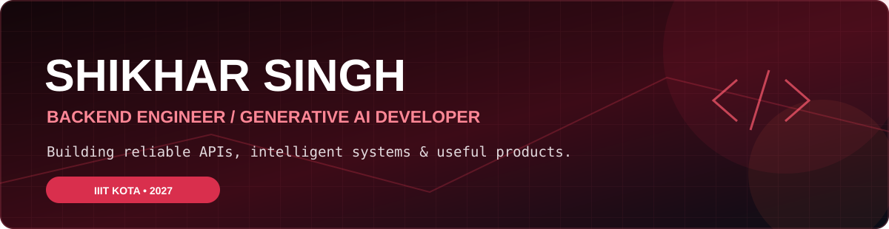

  

    
  

  
<b>Backend Engineering • Generative AI • System Design • Competitive Programming</b>

  
  
  
  

---

## 👨‍💻 About Me

I'm **Shikhar Singh**, an Electronics & Communication Engineering undergraduate at **IIIT Kota (Class of 2027)**, focused on building scalable backend services and practical Generative AI applications.

- 🔧 I work with **Python, FastAPI, Node.js, Express.js, PostgreSQL, and Redis**.
- 🤖 I build **RAG systems, LLM applications, and agentic workflows** using LangChain and LangGraph.
- 🧩 I enjoy **DSA, system design, API engineering, and microservices**.
- 🏆 Solved **500+ DSA problems** across LeetCode and GeeksforGeeks; **3-star CodeChef** rating.
- 🎯 Interested in **Software Engineer, Backend Engineer, and Generative AI Engineer** opportunities.

## 🛠️ Tech Stack

**Languages**

   

**Backend & Databases**

     

**AI & Developer Tools**

     

## 🚀 Featured Projects

### 🧠 PrepWise AI — AI Career Preparation Platform
A full-stack career preparation platform with **five Express services behind an API gateway**, Firebase authentication, Redis caching, MongoDB persistence, and a LangGraph-powered interview workflow. Includes resume analysis, interview feedback, voice interaction, and coding practice.

### 🎥 YouTube Smart Chatbot
A multilingual, transcript-grounded chatbot built with **Python, FastAPI, Streamlit, Groq, and Deepgram**, supporting long-form YouTube videos, timestamped captions, and contextual Q&A.

### 💰 WealthWise — AI Finance Platform
A finance management application using **Next.js, PostgreSQL, Prisma, and Gemini**, with receipt analysis, budget automation, and group expense splitting.

> Project repository links can be added once the exact URLs are confirmed.

## 📊 GitHub Activity

  
  

---

<b>Build thoughtfully. Learn continuously. Ship things that matter.</b>

